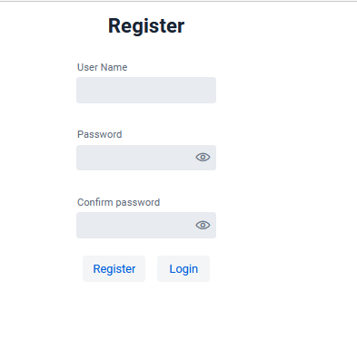
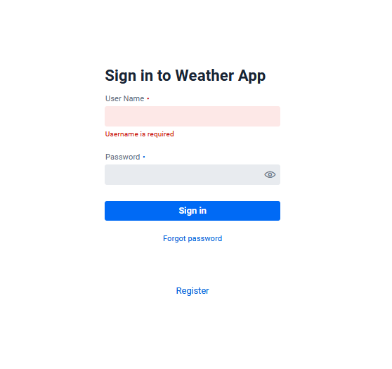
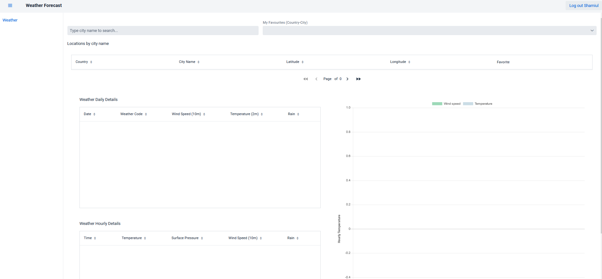
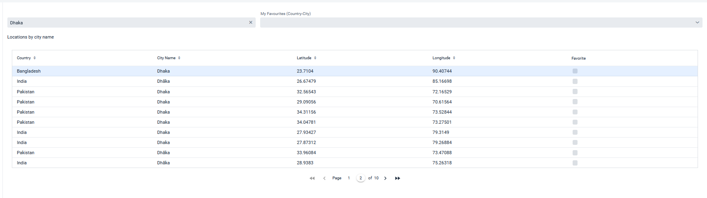
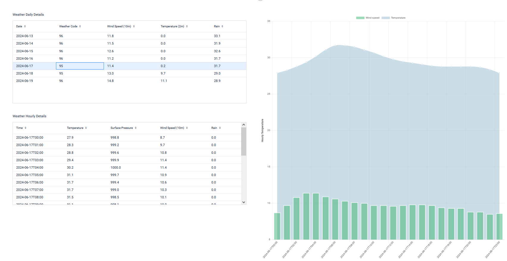

# WeatherApp

This is a weather application built using MySQL, Spring Boot,
Maven and Vaadin. The application allows users
to register, login, and view weather details.

## Features

- User Registration: New users can register to the application by providing a username and password.
- User Login: Registered users can login to the application using their username and password.
- Weather Details: The application provides detailed weather information including latitude, longitude, time, weather code, maximum wind speed at 10m, maximum temperature at 2m, and rain sum.

## Project Structure

The project is structured into several packages:

- `com.weatherapp.services`: Contains the `UserService` interface and its implementation. The `UserService` interface defines methods for user registration and fetching user details.
- `com.weatherapp.views`: Contains the `RegisterView` class which handles user registration.
- `com.weatherapp.detail`: Contains the `DailyUnitsDetail` class which represents the detailed weather information.

## Setup

To set up the project on your local machine, follow these steps:

1. Clone the repository to your local machine.
2. Navigate to the project directory.
3. Run `mvn clean install` to build the project and install the dependencies.
4. Start the application by running `mvn spring-boot:run`.
5. For DataBase setup, create a database named `weather` in MySQL.
6. Update the `application.properties` file with your MySQL username and password.
7. Use WeatherDB.sql file to create the required tables in the database.

## Usage

To use the application:

1. Open your web browser and navigate to `http://localhost:8080/register`.
2. Register a new user by providing a username and password.
3. Login to the application using the registered username and password.
4. Landing page will be displayed after successful login.
5. Enter the city name to view the city list.
6. View the weather details.

## Contributing

Contributions are welcome. Please make sure to update tests as appropriate.

